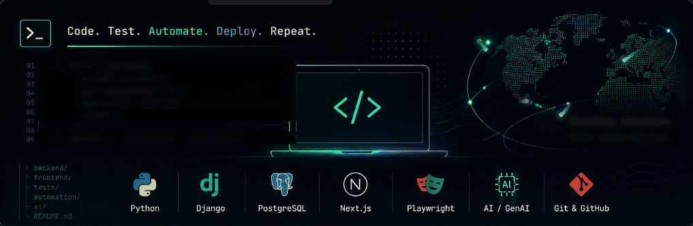

<div align="center">

# 👋 Hi, I'm **SAYYED SOHEB**

**🐍 Python & Django Developer · 🧪 QA Tester · 🎭 Automation · 🤖 Learning AI/GenAI**


<br>

<a href="https://github.com/sayyed-mohd-soheb">

</a>
&nbsp;
<a href="YOUR_LINKEDIN_URL">

</a>
&nbsp;
<a href="YOUR_PORTFOLIO_URL">

</a>
&nbsp;
<a href="mailto:YOUR_EMAIL">

</a>


📍 **Mumbai, India**  • **💻 Software Engineering** • **🚀 Fullstack**, **QA & Automation**
</div>

---

## 🧑‍💻 About Me

I'm a **Software Engineering enthusiast** focused on Backend Development, QA and Test Automation. I enjoy building practical applications, testing real-world software, and continuously improving my technical skills.

Currently working as a **QA / QA Automation Intern**, gaining hands-on experience with software testing, automation, JavaScript, Next.js and Playwright while continuing to strengthen my backend development skills with Python and Django.

```yaml
name: Sayyed Mohd Shoaib
role: Backend Developer | QA & Automation
education: Electronics & Telecommunication Engineering
currently: QA / QA Automation Intern
building: Next.js & Playwright projects
backend: Python | Django | REST APIs
learning: Test Automation | JavaScript | GenAI
goal: Software Engineer
location: Mumbai, India
```

> **Build → Test → Learn → Improve.**


## 🛠️ Tech Stack

<table align="center">
  <tr>
    <th><b>Category</b></th>
    <th><b>Technologies & Skills</b></th>
  </tr>

  <tr>
    <td><b>🐍 Languages</b></td>
    <td>
      <b>Python</b> • <b>JavaScript</b> • <b>SQL</b>
    </td>
  </tr>

  <tr>
    <td><b>🎨 Frontend</b></td>
    <td>
      <b>HTML</b> • <b>CSS</b> • <b>Bootstrap</b> • <b>JavaScript</b> • <b>Next.js</b>
    </td>
  </tr>

  <tr>
    <td><b>⚙️ Backend</b></td>
    <td>
      <b>Python</b> • <b>Django</b> • <b>Django REST Framework</b>
    </td>
  </tr>

  <tr>
    <td><b>🗄️ Databases</b></td>
    <td>
      <b>MySQL</b> • <b>PostgreSQL</b> • <b>MongoDB</b>
    </td>
  </tr>

  <tr>
    <td><b>🧪 Testing & Automation</b></td>
    <td>
      <b>Manual Testing</b> • <b>Test Case Design</b> • <b>Functional Testing</b> • <b>Regression Testing</b> • <b>API Testing</b> • <b>Playwright</b> • <b>Postman</b>
    </td>
  </tr>

  <tr>
    <td><b>🔧 Tools & Platforms</b></td>
    <td>
      <b>Git</b> • <b>GitHub</b> • <b>VS Code</b> • <b>Excel</b>
    </td>
  </tr>

  <tr>
    <td><b>🤖 AI & Data</b></td>
    <td>
      <b>GenAI</b>  • <b>NumPy</b> • <b>Pandas</b> • <b>Matplotlib</b> • <b>OpenCV</b>
    </td>
  </tr>

</table>
## Featured Projects

### Maa-Shaeb Caterers

A full-stack catering and e-commerce platform built with Django for managing menus, customer orders, and order tracking.
Designed with a PostgreSQL-backed architecture and integrated Cloudinary for efficient media management.

**Tech Stack:** `Python` • `Django` • `PostgreSQL` • `JavaScript` • `Cloudinary`

### Fruit Quality Defect Classification

A computer vision and deep learning project developed to detect and classify fruit quality defects from images.
Implemented image-based classification using TensorFlow, YOLO, and OpenCV for automated quality analysis.

**Tech Stack:** `Python` • `TensorFlow` • `YOLO` • `OpenCV`

---

## 🌱 Currently Learning

- JavaScript
- Next.js
- Playwright
- Test Automation
- GenAI / LLM concepts
- Backend Development

---

## 🎯 Career Goal

I’m focused on becoming a strong Software Engineer with expertise in Backend and Full Stack Development, while continuously learning AI and building practical skills in Test Automation using tools like Playwright.


---

## 📫 Connect With Me

- LinkedIn
- Portfolio
- GitHub
- Email
